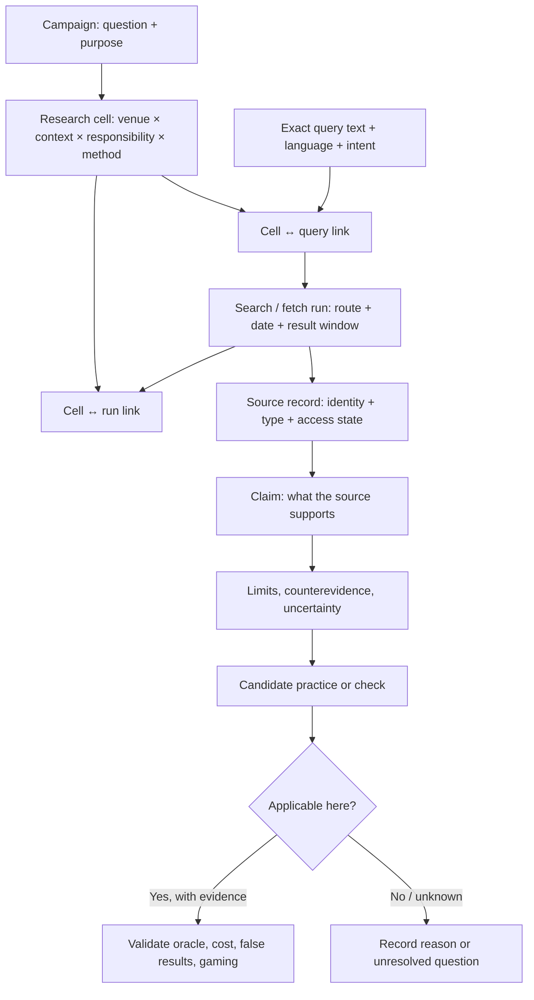
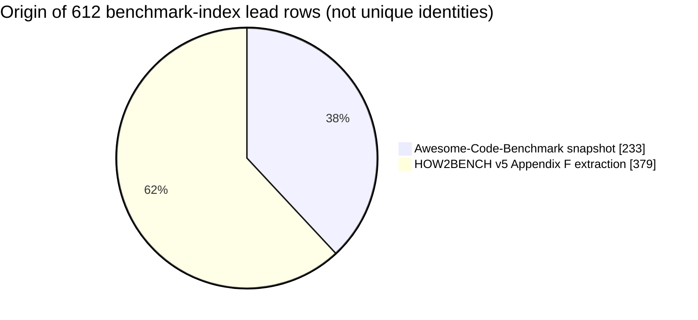

# Repository Quality Framework Research

> **Research workspace — not a finished framework.** This repository is building the evidence base for a general-purpose way to improve software repositories and the systems they support. It does not yet define a universal score, checklist, template, or set of mandatory gates.

The aim is to get beyond “the code compiles” and the generic repo-health checklist. A browser, compiler, operating system, game engine, firmware image, data pipeline, payment service, security tool, research artifact, or small library has different failure modes and obligations. The eventual framework must discover those differences, state when a check applies, and show what evidence supports it.

## At a glance

| | Current snapshot (2026-11-10) |
|---|---:|
| Research campaigns | 27 |
| Saved query records | 344 |
| Planned research cells | 133 |
| Research dimensions (axes) | 30 |
| Seeded axis-value rows | 509 |
| Cell ↔ query links | 348 |
| Cell ↔ search-run links | 271 |
| Search-ledger records | 176 |
| Candidate source routes | 177 |
| Source-register records | 173 |
| Candidate benchmark-index rows | 612, not canonicalized |
| Sourced failure-pattern cards | 33 |
| Cells judged saturated | **0** |

These are counts of records in this workspace, not counts of unique sources, validated benchmarks, or completed coverage. The current work is a **research map with selected evidence**, not a claim that the universe has been searched.

### Planned-cell status

```text
Thin                   109 / 133  █████████████████████████████████████████
Queued                  21 / 133  ████████
No evidence found        2 / 133  █
Static source only       1 / 133  ▍
Saturated                0 / 133
```

“No evidence found” means a specified query/route did not surface evidence. It never means the topic has no evidence. Most work is intentionally marked **thin** because source samples, appraisal, replication, or scope coverage remain incomplete.

## What this project is trying to model

Repository quality is a relationship among the work, its system context, the people affected, its lifecycle, and the evidence used to judge it. A source, badge, metric, or test can illuminate one slice; none is a universal proxy for quality.

```mermaid
flowchart LR
    B[Brief, repository, or system] --> D[Decompose the system and its boundaries]
    D --> C[Identify components, interfaces, dependencies, and operating context]
    C --> R[Map responsibilities, stakeholders, and lifecycle]
    R --> F[Find candidate failure modes and desired outcomes]
    F --> E[Choose evidence, oracle, workload, and measurement]
    E --> A[Appraise standards, research, practice, tools, and counterexamples]
    A --> G[Candidate checks with applicability and known limits]
    G --> V[Validate cost, false results, gaming, and real-world usefulness]
    V --> D
```



The loop matters: a check can expose a missing system boundary, a failed benchmark can reveal a bad oracle, and a counterexample can change the original requirement. The eventual framework should be assembled from supported, applicable mechanisms—not from an unexamined mega-checklist.

### Open-ended system decomposition

The system catalogue must stay open. It is a graph that can be recursively expanded, not a list of a few popular app categories.

```text
WORK / SYSTEM
├── purpose, users, environment, constraints, harms
├── system boundary and external services / devices / operators
├── components and layers (expand recursively)
│   ├── interfaces, state, data, protocols, dependencies
│   ├── algorithms, runtimes, build and release machinery
│   └── deployment, observability, recovery, governance
├── responsibilities and lifecycle decisions
├── failure histories, threat models, workload and use conditions
└── evidence and oracles for each claim
```

The current working model and examples live in [the open-ended systems model](docs/open-ended-systems-model.md), [stress cases](research/v2/systems/stress-cases.csv), [capability catalogue](research/v2/systems/capability-catalog.csv), [compound cells](research/v2/systems/compound-research-cells.csv), and [worked browser decomposition](research/v2/systems/worked-decomposition.md). This model is still provisional. The full pasted Computer System Atlas has now been read; its detailed integration and the user’s separate, pending technology-role list remain open. See the [Atlas intake audit](research/audit/atlas-intake-audit.md).

## The research matrix

The conceptual matrix is a product of dimensions, filtered for applicability and sampled deliberately. A full Cartesian product would be enormous and mostly nonsensical; the goal is traceable coverage across important combinations, including counterexamples and gaps.

| Dimension group | Example axes currently represented |
|---|---|
| Source and discovery | venue type, source role, geography, language, access route, time, query intent, research freshness, method, status |
| System and work context | artifact, project context, language ecosystem, framework/runtime, deployment environment, workload/measurement, lifecycle |
| Responsibility and outcome | responsibility, stakeholder role, outcome/harm, evaluation mechanism, assessment unit, performance metric, bloat type |
| Benchmark-specific | benchmark identity unit, oracle validation, run contract, result reporting, lifecycle, sampling/leakage |

There are **30 current axes** and **509 seeded axis-value rows**. These are vocabulary and planning records; they are not a final ontology. The older flat matrix remains historical and is being reconciled into the linked v2 model.



This normalized structure allows one search run to inform multiple cells and one cell to receive evidence from multiple queries and runs. See [research model v2](docs/research-model-v2.md), [matrix model](docs/matrix-model.md), [research protocol](docs/research-protocol.md), [method design](research/v2/methods/evidence-research-methods.md), and the [integrity/migration notes](research/v2/integrity-and-migration.md).

## Evidence gathered so far

### 1. Raters and repository signals are different kinds of instruments

The initial mechanism audit found weighted repository-health scores, criterion badges, checklists, maturity rubrics, community metric catalogues, component-selection services, licensing estimators, and popularity/criticality measures. These ask different questions and observe different evidence. A licensing/value estimate such as the supplied pre.dev example is not a general software-quality rater. Stars, downloads, test-file presence, or a passing scanner cannot be treated as direct measurements of overall quality.

The first evaluator and metric leads are indexed in [the rater inventory](research/rater-inventory.csv) and [mechanism audit](research/mechanism-audit.md). The comparative audit is not complete: independent outcome validity, missing-data behavior, applicability, incentives, gaming, and false-positive/false-negative rates remain open.

### 2. Quality includes behavior across histories, not only isolated functions

The user-provided settings-panel example motivates a useful *candidate* property: alternate triggers for one action should preserve the relevant behavioral contract. The transcript itself does not prove that code duplication caused the bug. The research therefore follows observable state transitions and their oracles: click, Escape, backdrop, platform back, focus, animation, repeated input, event propagation, cancellation, retries, and interleavings where applicable.

The current evidence note contains **33 failure-pattern/community/tool-evaluation cards**. The cases span UI path divergence, cancellation, service shutdown races, duplicate external effects, IME events, stale async responses, database/index consistency, firmware reset ordering, publish-time artifact failures, generated/deployed drift, workload regressions, insecure patterns copied from a repository, policy violations despite functional tests, test-oracle weakness, and agent-reported bugs that do not reproduce. Evidence strength varies: verified project fixes, standards/conformance evidence, research results, practitioner reports, and unverified leads are kept distinct.

Read the [full failure-pattern batch](research/v2/failure-patterns/initial-evidence-batch.md), [modal path-equivalence analysis](research/v2/failure-patterns/modal-path-equivalence.md), and [focused research handoff](docs/failure-pattern-research-handoff.md). No general detector or mandatory rule has been validated from this batch.

### 3. System-specific standards, tests, and benchmarks cannot be collapsed into one score

Current benchmark work covers repository change and maintenance, oracle validity, hidden requirements, test generation, mutation, contamination, performance and bloat, code reuse, repeatability, and lifecycle maintenance. The landscape also includes system-specific candidates for browsers, databases, compilers, operating systems, embedded systems, AI infrastructure, security, media, geospatial, and other domains. Some candidates are conformance standards, fuzzers, test frameworks, or simulations; they only become a benchmark for a defined task when task, oracle, environment, and scoring contract are specified.

The [benchmark landscape and method audit](research/v2/benchmarks/benchmark-landscape-and-method-audit-2026-11.md) and [candidate index](research/v2/benchmarks/candidate-index-leads.csv) preserve the current boundaries. The 612 index rows come from two source snapshots; they are uncanonicalized leads, **not 612 unique benchmark suites**.



The 672 analysis units reported in HOW2BENCH do not map one-to-one to the 379 extracted Appendix F records. A separate corpus of 425 non-functional-improvement studies is a set of studies, not 425 benchmark suites. Identity resolution, alias consolidation, task-level appraisal, and a declared stratified primary-source sample remain future work.

### 4. AI-generated work needs outcome, maintenance, and measurement evidence

The AI research lane separates behavior passing from repository maintainability, test-oracle quality, post-merge survival, inherited test failures, cross-repository tasks, security context, long-horizon work, research artifacts, and AI infrastructure. It includes evidence and leads such as RepoNorm, SWE-CC, SWE-Maintain, CrossSWE, InfraDev, Infrathon, TestExplora, benchmark contamination/reliability work, and research-feed freshness audits. A useful counterexample matters: the paired Python SWE-Maintain study did not establish a general maintenance penalty; much of the observed later-task issue was tied to inherited failing tests.

See [empirical evidence on agent-authored changes](research/v2/agent-quality/empirical-evidence-batch.md), [repository maintainability and lab artifacts](research/v2/agent-quality/ai-generated-repository-maintainability-and-lab-artifacts-2026-11.md), [cross-domain AI evaluation routes](research/v2/agent-quality/cross-domain-ai-evaluation-and-research-routes-2026-11.md), and [current lab artifacts/frontier evidence](research/v2/agent-quality/current-lab-artifacts-and-frontier-evidence-2026-11.md). These are selected current-source samples, not a complete lab census, and their benchmarks were not run.

### 5. Efficiency and cleanliness require workload-specific evidence

The project has a dedicated performance/bloat lane. Smaller code, fewer dependencies, or fewer lines are not automatically better: a transformation may change behavior, build time, startup time, memory, energy, artifact size, runtime performance, or downstream workload behavior in different directions. Any simplification or optimization must preserve an appropriate behavioral oracle and measure the actual target environment and workload.

The current sources and candidate tools are in [performance and bloat](research/v2/specialization/performance-and-bloat.md), [specialization tooling](research/v2/specialization/tooling.csv), and [ecosystem profiles](research/v2/specialization/ecosystem-profiles.csv). No shared measurement protocol or universally meaningful “leanest” target is selected.

## Research routes and limits

The source map includes candidates across code forges, social networks, Q&A, forums, mailing lists, standards bodies, scholarly indexes, lab repositories, benchmark datasets, practitioner writing, and operational records. Routes sampled so far include Parallel, Exa, connected GitHub search/read, connected X search and the user’s signed-in Brave browser, public Reddit search, the Hacker News Algolia/Firebase route, and the Stack Exchange API. See [candidate source universe](docs/source-universe.md), [source register](research/source-register.csv), [v2 route inventory](research/v2/source-routes.csv), and the exact [search log](research/search-log.md).

| Route sampled | What was actually inspected | Boundary |
|---|---|---|
| Hacker News native API route | Five query windows; four threads and 18 comments sampled | Not full-site coverage; query and date windows matter |
| Stack Overflow API | Two query windows; two questions, four answers, one comment inspected | Partial API sample; not platform saturation |
| Reddit in Brave | Two direct threads, including one Portuguese thread | Small sample; no broad subreddit or language coverage |
| X via connected search / signed-in Brave | A few bounded query windows; selected leads retained | Noisy/low-yield in some searches; lead discovery, not prevalence |
| Parallel, Exa, GitHub endpoints | Search and selected primary/owner pages | Ranked result windows; zero results are query-local |
| Paper and lab discovery portals | Selected portal snapshots and paper-to-artifact routes | Freshness/coverage differs; portal counts are not recall estimates |

The full log records exact queries where retained, route, result window, access state, fetches, and known limitations. Some early work is explicitly retrospective because the original exact query strings were lost during context compression; those details were not fabricated. The platform/source universe remains incomplete, especially across regional and non-English routes, private/member-gated spaces, and domain-specific practitioner communities.

## How to continue research here

1. Read [the continuity ledger](RESEARCH_STATE.md) first. It records verified state, gaps, and next work.
2. Read [the integrated roadmap](docs/integrated-research-roadmap.md) and [execution handoff](docs/execution-handoff.md) before starting a new batch.
3. Select a question and justified set of compound cells; do not pretend the full Cartesian product is searchable.
4. Use more than one discovery route where possible. Go from search lead to primary source, implementation, dataset, issue/PR, or original thread.
5. Record exact query text, date/time, platform/route, filters, language, result window, screening decisions, and access failures in the log and linked tables.
6. Extract claims with their assessment unit, sample, method, oracle, version, limitations, and counterevidence. Keep inference distinct from what the source says.
7. Update `RESEARCH_STATE.md` and the linked campaign/query/cell/run/source records. Check IDs and foreign keys before reporting counts.
8. Do not promote a candidate into a gate until applicability, evidence, oracle quality, false results, burden, incentives, gaming, and exceptions have been examined.

See [evidence-research methods](research/v2/methods/evidence-research-methods.md) and the detailed [research protocol](docs/research-protocol.md). `AGENTS.md` contains contributor instructions.

## Repository map

| Path | Purpose |
|---|---|
| [`RESEARCH_STATE.md`](RESEARCH_STATE.md) | Current truth, chronology, known limits, and next actions |
| [`docs/integrated-research-roadmap.md`](docs/integrated-research-roadmap.md) | Sequenced program, evidence contract, and self-correction criteria |
| [`docs/research-protocol.md`](docs/research-protocol.md) | Search, screening, appraisal, coverage, and stopping rules |
| [`docs/source-universe.md`](docs/source-universe.md) | Candidate source/platform/venue map; explicitly not exhaustive |
| [`docs/research-model-v2.md`](docs/research-model-v2.md) | Linked campaign, query, cell, run, and route data model |
| [`docs/open-ended-systems-model.md`](docs/open-ended-systems-model.md) | Recursive system decomposition and compound cells |
| [`docs/decisions.md`](docs/decisions.md) | Decisions made and open questions |
| [`docs/audit-and-recovery-plan.md`](docs/audit-and-recovery-plan.md) | Bounded audit findings and execution checkpoints with review criteria |
| [`research/audit/2026-11-10-audit-findings.md`](research/audit/2026-11-10-audit-findings.md) | Partial session, source-claim and data integrity audit with corrections |
| [`research/audit/2026-11-10-followup.md`](research/audit/2026-11-10-followup.md) | Failure-card source census, recovered runs, corrections and remaining gaps |
| [`docs/failure-pattern-research-handoff.md`](docs/failure-pattern-research-handoff.md) | How to continue collecting failures and designing behavioral checks |
| [`docs/atlas-context-recovery.md`](docs/atlas-context-recovery.md) | What was reviewed from the Computer System Atlas and what remains |
| [`research/search-log.md`](research/search-log.md) | Detailed query/run/fetch/access log, including retrospective boundaries |
| [`research/search-ledger.csv`](research/search-ledger.csv) | Compact search-run index |
| [`research/v2/`](research/v2/) | Current linked research data, evidence batches, specialization, systems, AI, and benchmark work |
| [`docs/research-progress-report-2026-11-10.md`](docs/research-progress-report-2026-11-10.md) | Detailed local report on work, findings, obstacles, and remaining gaps |

## Status and deliverable boundary

**Current phase:** broaden, verify, and appraise research; repair provenance; integrate system roles and atlas context. The role list the user intends to provide is still pending.

**Not yet produced:** exhaustive source inventory, complete system/role taxonomy, validated and complete matrix, independent comparative audit of all raters, validated universal gates, framework specification, scoring/weighting model, implementation, benchmark execution, or repository template.

**Do not call this complete** because many records exist. Completion needs an agreed scope; evidence-backed applicability and gate designs; explicit known gaps and cost/false-result analysis; validation against heterogeneous real systems; and user review. “Thin,” “inaccessible,” “conflicting,” “no evidence found,” and “saturated” refer to recorded cells and methods, not to whole disciplines or platforms.

## Local working state

The research bundle had an existing published checkpoint at `063b34a`. This expanded README and the accompanying progress report are being published to the same GitHub repository at the user's request.


### Scale-oriented discovery checkpoint

The user requested sustained expansion toward thousands of candidates per relevant class. A [first bounded collection](research/discovery/2026-11-10-scale-tranche/RESULTS.md) contains 1,577 unreviewed issue links and 8,984 pinned source-file leads across four specialist trees. These units are not verified defects, distinct designs or coverage. [Further source routes and scale rules](research/discovery/2026-11-10-scale-tranche/next-source-campaigns.md) describe the broader work still open.


The [open-world Atlas and failure-corpus direction](research/discovery/2026-11-10-open-world/atlas-and-failure-corpus.md) records the user’s latest clarification: recursively investigate all kinds of systems and historical bugs, fixes, tests, discussions, and operational consequences across open-source projects and technical communities. Current leads and worked examples are a start, not a fixed scope or complete corpus.
